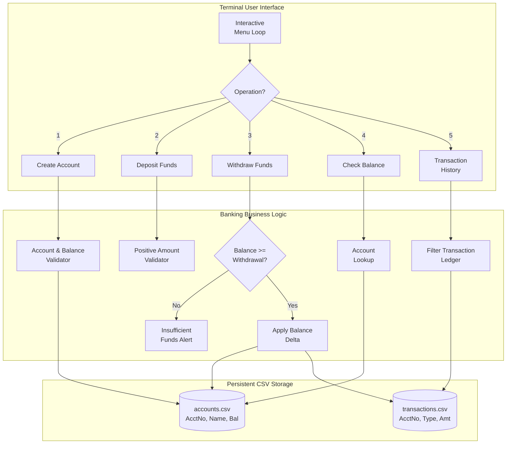

<p align="center">
  
</p>

# ◈ Banking Management System

[](https://github.com/ISBANDURAHUMAN-R/Banking-Management-System/actions/workflows/ci.yml)

## ◆ About the Project
The Banking Management System is a command-line financial management program developed in Python. It provides core personal banking operations including account creation, money deposits, withdrawals with overdraft checks, balance inquiries, and historical transaction logging using persistent CSV storage.

## ❖ Key Features
- Bank account registration and initialization with unique account numbers.
- Secure deposit and withdrawal processing with balance validation.
- Real-time balance inquiry for registered accounts.
- Automated ledger recording storing transaction logs in `transactions.csv` and account states in `accounts.csv`.
- Menu-driven console interface designed for terminal navigation.

## ◆ System Architecture


## ⬢ Technologies Used
- Python 3
- Python Standard Library (`csv`, `os`, `datetime`)

## § Requirements
- Python 3.8 or higher

## ▲ Installation & Execution
```bash
# Run the application
python main.py
```

## ※ Developer
Developer: ISBANDU RAHUMAN R  
GitHub: https://github.com/ISBANDURAHUMAN-R
